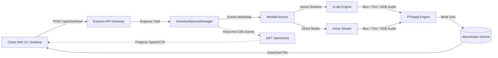

# ⚡ Ultimate Downloader

<p align="center">
  
</p>

<p align="center">
  <strong>The Ultimate Universal Cross-Platform Video Downloader, Audio Extractor & Bulk Media Scraper</strong>
</p>

<p align="center">
  <a href="https://github.com/hoshirun/ultimate-downloader/releases"></a>
  <a href="https://github.com/hoshirun/ultimate-downloader/actions"></a>
  <a href="https://nodejs.org">=22.0.0-informational.svg?style=flat-square" alt="Node.js 22+" /></a>
  <a href="https://www.typescriptlang.org"></a>
  <a href="#platform-support-matrix"></a>
  <a href="LICENSE"></a>
  <a href="https://github.com/hoshirun/ultimate-downloader/pulls"></a>
</p>

```
  _   _ _ _   _                 _          ____  _
 | | | | | |_(_)_ __ ___   __ _| |_ ___   |  _ \| |
 | | | | | __| | '_ ` _ \ / _` | __/ _ \  | | | | |
 | |_| | | |_| | | | | | | (_| | ||  __/  | |_| | |___
  \___/|_|\__|_|_| |_| |_|\__,_|\__\___|  |____/|_____|
```

---

## 🚀 Overview

**Ultimate Downloader** is a high-performance, developer-friendly media extraction suite engineered to download, transcode, and archive media from virtually any URL on the internet.

Whether you need **crystal-clear 4K YouTube videos**, **watermark-free TikTok reels**, **studio-grade 320kbps MP3 audio**, or **bulk image scraping from any webpage into an instant ZIP archive**, Ultimate Downloader provides a unified, cross-platform engine packaged for Web, Desktop (Electron), Docker, and headless CLI.

---

## ✨ Features

### 🎬 4K & 1080p Video Downloads
- Extracts video streams up to **4K (2160p 60fps)**, **1440p (2K)**, **1080p Full HD**, and **720p HD**.
- High-fidelity audio/video muxing using native FFmpeg with lossless stream copying when available.
- Adaptive bitrate and container format selection (`mp4`, `mkv`, `webm`).

### 🎵 320kbps Studio Audio Extractor
- One-click extraction from video URLs directly into **320kbps High Fidelity MP3**, **FLAC**, **WAV**, or **AAC**.
- Automated ID3 metadata tagging (title, artist, album art thumbnail).
- Built-in silence stripping and normalize audio output.

### 🖼️ Batch Webpage Image Scraper & Instant ZIP
- Enter any URL (e.g. Unsplash, blogs, galleries, documentation) to crawl and extract all embedded images (``, `srcset`, OpenGraph `og:image`, Twitter Cards).
- Real-time thumbnail preview grid with resolution badges.
- Select all or pick individual images to download as a **streamed PKZIP archive** with zero server-side disk thrashing.

### ✂️ In-App Video Trimmer & Timestamp Clipper
- Set custom start (`trimStart`) and end (`trimEnd`) timestamps (`HH:MM:SS` or seconds).
- Millisecond-accurate FFmpeg clipping without quality degradation.
- Download only the essential clip rather than entire multi-gigabyte recordings.

### ⚡ Real-Time Progress Tracking via Server-Sent Events (SSE)
- Non-polling, low-latency live telemetry stream.
- Real-time download speed calculation (in **MB/s** and **KB/s**).
- Estimated Time of Arrival (**ETA** countdown) and percentage progress bars.

### 🖥️ True Cross-Platform Ecosystem
- **Modern Web SPA**: Responsive React 18 frontend with dark/light mode and mobile optimization.
- **Desktop App (Electron)**: Native OS system tray, background minimization, desktop completion notifications, and native directory pickers.
- **Docker Ready**: Production-grade multi-stage container image based on `node:22-bookworm-slim` with bundled FFmpeg and yt-dlp.
- **Headless CLI**: Scriptable command-line interface (`ultimate-dl`) for automated terminal pipelines.

### 🎨 Sleek UI/UX Pro Max Dark Interface
- Built with **Tailwind CSS v3.4**, **Lucide Icons**, and custom glowing cyber-accent design tokens.
- Instant heuristic platform badge detection as soon as a URL is pasted.
- Toast notifications, persistent download history drawer in `localStorage`, and comprehensive settings modal.

---

## 📊 Platform Support Matrix

| Platform | Video Quality | Audio Extractor | Batch / Gallery | Watermark Free | Status |
|:---------|:-------------:|:---------------:|:---------------:|:--------------:|:------:|
| **YouTube** | Up to 4K 60fps | ✅ 320kbps MP3/WAV | ✅ Playlists / URLs | N/A | 🟢 Supported |
| **TikTok** | 1080p Full HD | ✅ Original Sound | ❌ Single Video | ✅ Yes (Clean) | 🟢 Supported |
| **Instagram** | 1080p Reels/Video | ✅ Audio Track | ✅ Carousels | ✅ Yes | 🟢 Supported |
| **X (Twitter)** | Highest Available | ✅ Audio Track | ❌ Single Tweet | ✅ Yes | 🟢 Supported |
| **Reddit** | 1080p (Audio Muxed) | ✅ Extracted Audio | ❌ Single Post | ✅ Yes | 🟢 Supported |
| **Pinterest** | HD Video Pins | ❌ No Audio | ✅ Pin Images | ✅ Yes | 🟢 Supported |
| **Facebook** | Public HD / SD | ✅ Audio Track | ❌ Single Video | ✅ Yes | 🟢 Supported |
| **Vimeo** | Up to 4K | ✅ Audio Track | ❌ Single Video | ✅ Yes | 🟢 Supported |
| **SoundCloud** | N/A (Audio Only) | ✅ High Quality MP3 | ❌ Single Track | N/A | 🟢 Supported |
| **Direct Links** | Source Resolution | ✅ Audio Extract | ❌ Single File | N/A | 🟢 Supported |
| **Any Webpage** | N/A | N/A | ✅ Full Image ZIP | N/A | 🟢 Supported |

---

## ⚡ Quick Start Guide

### 1. Local Development (Instant One-Liner)

#### Linux & macOS:
```bash
git clone https://github.com/hoshirun/ultimate-downloader.git
cd ultimate-downloader
chmod +x start.sh
./start.sh
```

#### Windows (Command Prompt / PowerShell):
```cmd
git clone https://github.com/hoshirun/ultimate-downloader.git
cd ultimate-downloader
start.bat
```

The startup script will automatically check your Node.js version, verify FFmpeg, install workspace dependencies, launch both backend and frontend concurrently, and open `http://localhost:5173` in your default browser.

---

### 2. Manual Setup (npm workspaces)

Ensure you have **Node.js 22 LTS** (or 20+) and **FFmpeg** installed.

```bash
# 1. Install root and workspace dependencies
npm install

# 2. Start both server and client in development mode
npm run dev

# 3. Access web interface
# Frontend: http://localhost:5173
# Backend:  http://localhost:4000/api/health
```

---

### 3. Docker Deployment (Recommended for Production)

Run the containerized stack using Docker Compose:

```bash
# Launch container detached
docker compose up -d

# Verify container status and logs
docker compose ps
docker compose logs -f
```

Or run via standard Docker CLI:

```bash
docker build -t ultimate-downloader -f docker/Dockerfile .
docker run -d \
  -p 4000:4000 \
  -v $(pwd)/downloads:/app/downloads \
  --name ultimate-downloader \
  ultimate-downloader
```

Open `http://localhost:4000` in your browser.

---

### 4. Desktop App (Electron)

Run Ultimate Downloader as a native desktop application with system tray and OS notifications:

```bash
# Development mode
npm run electron:dev

# Build standalone desktop installer (Windows .exe, macOS .dmg, Linux .AppImage)
npm run electron:build
```

---

### 5. Headless Command-Line Interface (CLI)

Download videos or extract audio directly from your terminal:

```bash
# Using npm script
npm run cli -- "https://www.youtube.com/watch?v=dQw4w9WgXcQ"

# Or using npx
npx ultimate-dl "https://www.youtube.com/watch?v=dQw4w9WgXcQ" --quality 1080p

# Extract 320kbps MP3 audio only
npx ultimate-dl "https://www.youtube.com/watch?v=dQw4w9WgXcQ" --audio-only

# Trim video clip (00:00:15 to 00:00:45)
npx ultimate-dl "https://www.youtube.com/watch?v=dQw4w9WgXcQ" --trim-start 00:00:15 --trim-end 00:00:45
```

---

## 🏛️ System Architecture

Ultimate Downloader is architected as an asynchronous, event-driven streaming pipeline:



For comprehensive engineering specifications, sequence diagrams, and lifecycle state machines, view the [Architecture Documentation](docs/ARCHITECTURE.md).

---

## 📖 REST API Reference Preview

The backend exposes a clean, typed REST API. Complete schema specifications and curl examples are detailed in [docs/API.md](docs/API.md).

| Method | Endpoint | Description |
|:-------|:---------|:------------|
| `GET` | `/api/health` | System health, dependencies (`ffmpeg`, `yt-dlp`), and disk stats |
| `POST` | `/api/info` | Inspect URL and fetch resolution formats, duration, thumbnail |
| `POST` | `/api/download` | Queue background download task (supports format, audio-only, trim) |
| `GET` | `/api/tasks` | List all active and queued download tasks |
| `GET` | `/api/tasks/:taskId` | Retrieve detailed progress telemetry for a single task |
| `DELETE`| `/api/tasks/:taskId` | Cancel task and clean temporary scratch files |
| `GET` | `/api/events` | **Server-Sent Events (SSE)** real-time push streaming |
| `POST` | `/api/images/extract` | Scrape all embedded and social images from any webpage |
| `POST` | `/api/download-zip` | Stream dynamic ZIP archive of selected image URLs |
| `GET` | `/api/downloads/:file`| Serve completed media asset with HTTP Range requests |

---

## ⚙️ Configuration & Environment Variables

Create a `.env` file in `server/` or pass variables via Docker / CLI:

| Variable | Default | Description |
|:---------|:--------|:------------|
| `PORT` | `4000` | HTTP port for Express backend service |
| `HOST` | `0.0.0.0` | Binding network host interface |
| `NODE_ENV` | `development` | Runtime environment (`development` or `production`) |
| `DOWNLOAD_DIR` | `./downloads` | Path to store finished and temporary downloads |
| `SIMULTANEOUS_DOWNLOAD_LIMIT` | `3` | Maximum number of concurrent active download tasks |
| `CLIENT_DIST` | `../client/dist`| Path to compiled Vite frontend assets in production |
| `LOG_LEVEL` | `info` | Logging verbosity (`debug`, `info`, `warn`, `error`) |

---

## 🧪 Testing

The repository includes an automated test suite verifying platform URL detection, format parsing, Cheerio image scraping, task queue state transitions, and FFmpeg command construction:

```bash
# Run complete test suite using Node.js standard test runner
node tests/run-tests.js

# Or run via npm
npm test
```

---

## 🤝 Contributing

Contributions, issues, and feature requests are welcome!
Feel free to check [issues page](https://github.com/hoshirun/ultimate-downloader/issues).

1. Fork the Project
2. Create your Feature Branch (`git checkout -b feature/AmazingFeature`)
3. Commit your Changes (`git commit -m 'feat: Add AmazingFeature'`)
4. Push to the Branch (`git push origin feature/AmazingFeature`)
5. Open a Pull Request

---

## 📄 License

Distributed under the **MIT License**. See [LICENSE](LICENSE) for more information.

---

<p align="center">
  Crafted with ❤️ by <a href="https://github.com/hoshirun">Hoshirun</a> and contributors.
</p>
