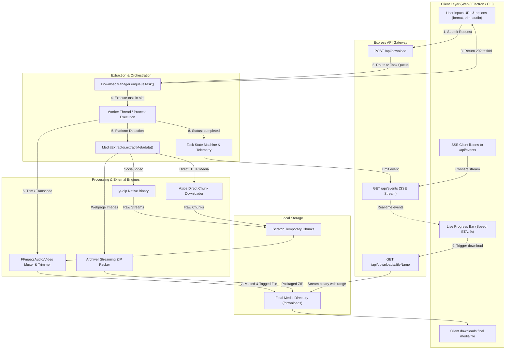
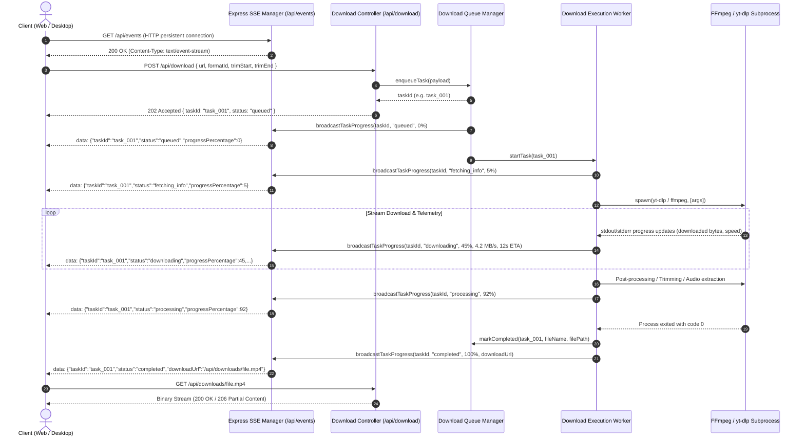
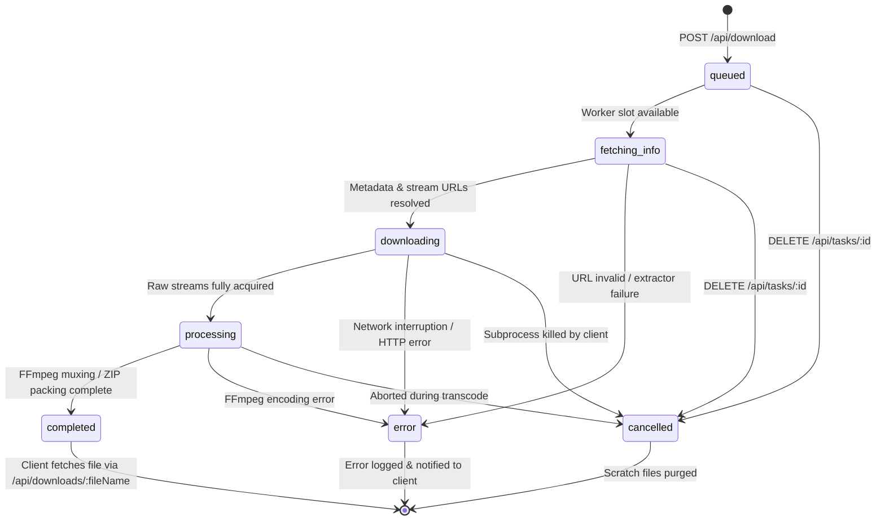
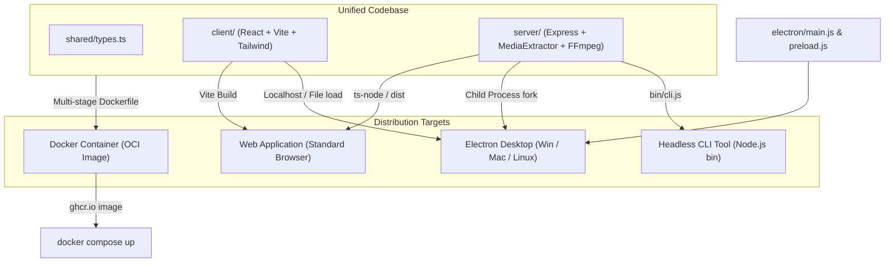

# Ultimate Downloader — Architecture & Engineering Specification

This document details the architectural blueprints, component hierarchies, real-time event lifecycles, and multi-platform packaging mechanisms powering **Ultimate Downloader**.

---

## Table of Contents

- [System Overview](#system-overview)
- [End-to-End Request Handling Flow](#end-to-end-request-handling-flow)
- [Real-Time Event Pipeline (SSE Sequence)](#real-time-event-pipeline-sse-sequence)
- [Core Architecture Subsystems](#core-architecture-subsystems)
  - [1. Presentation Layer (Vite + React)](#1-presentation-layer-vite--react)
  - [2. API Gateway & Controller Layer (Express)](#2-api-gateway--controller-layer-express)
  - [3. Media Extraction Engine (`MediaExtractor`)](#3-media-extraction-engine-mediaextractor)
  - [4. Task Queue & State Machine (`DownloadManager`)](#4-task-queue--state-machine-downloadmanager)
  - [5. Media Processing Pipeline (`FfmpegService`)](#5-media-processing-pipeline-ffmpegservice)
  - [6. Image Archival Subsystem (`Archiver`)](#6-image-archival-subsystem-archiver)
- [Task Lifecycle State Machine](#task-lifecycle-state-machine)
- [Multi-Platform Packaging Architecture](#multi-platform-packaging-architecture)
  - [Web Application Deployment](#web-application-deployment)
  - [Docker Containerization](#docker-containerization)
  - [Electron Desktop Application](#electron-desktop-application)
  - [Headless Command-Line Interface (CLI)](#headless-command-line-interface-cli)
- [Performance, Resilience & Security](#performance-resilience--security)

---

## System Overview

Ultimate Downloader is engineered as a decoupled, event-driven media processing system. It enables instantaneous media analysis, multi-resolution video downloading, studio-grade audio extraction, and bulk image scraping across major content platforms with a unified visual interface.

```
                      +---------------------------------------+
                      |       Clients & Interfaces            |
                      |  [Web UI]  [Electron]  [CLI]  [cURL]  |
                      +-------------------+-------------------+
                                          |
                                          v  HTTP REST / SSE
                      +---------------------------------------+
                      |       Express API Gateway             |
                      |   CORS, Rate Gate, Request Router     |
                      +-------------------+-------------------+
                                          |
                +-------------------------+-------------------------+
                |                                                   |
                v                                                   v
+-------------------------------+                   +-------------------------------+
|     MediaExtractor            |                   |    DownloadQueueManager       |
|  - Platform URL Matcher       |                   |  - FIFO Worker Concurrency    |
|  - yt-dlp Native Bridge       |                   |  - Progress Tracking          |
|  - Cheerio HTML DOM Crawler   |                   |  - SSE Event Broadcast Hub    |
+---------------+---------------+                   +---------------+---------------+
                |                                                   |
                +-------------------------+-------------------------+
                                          |
                +-------------------------+-------------------------+
                |                                                   |
                v                                                   v
+-------------------------------+                   +-------------------------------+
|     FfmpegService             |                   |     ArchiverService           |
|  - Lossless Stream Trimming   |                   |  - Bulk Image Bundler         |
|  - 320kbps Audio Transcoder   |                   |  - Streamed ZIP Generator     |
|  - Format Remuxing (MP4/MKV)  |                   |  - Non-blocking I/O           |
+---------------+---------------+                   +---------------+---------------+
                |                                                   |
                +-------------------------+-------------------------+
                                          |
                                          v
                      +---------------------------------------+
                      |   Disk Storage (/downloads)           |
                      |   Range Requests / Static Server      |
                      +---------------------------------------+
```

---

## End-to-End Request Handling Flow

The following Mermaid diagram traces a download operation from initial URL submission in the UI through format detection, queued background processing, FFmpeg transcoding/trimming, and client retrieval:



---

## Real-Time Event Pipeline (SSE Sequence)

The real-time telemetry pipeline relies on standard HTTP Server-Sent Events (`text/event-stream`), avoiding the heavy handshake overhead of WebSockets while ensuring automatic browser reconnection and proxy compatibility:



---

## Core Architecture Subsystems

### 1. Presentation Layer (Vite + React)

- **UI Framework**: React 18 with TypeScript in strict mode.
- **Styling**: Tailwind CSS configured with custom glassmorphism layers, glow effects, and modern Dark Theme palette.
- **Iconography**: `lucide-react` for responsive, accessible vector icons.
- **State Architecture**:
  - `sseClient`: Manages singleton `EventSource` connection with graceful offline mock fallbacks.
  - `HistoryDrawer`: Synchronizes completed downloads to persistent `localStorage` with export capabilities.
  - `MediaInputCard`: Immediate platform icon detection as the user pastes URLs via heuristic regular expressions.
  - `BatchUrlModal`: Multi-line bulk ingestion dialog with format presets.
  - `ImageGalleryExtractor`: Grid view for webpage image previews with multi-select and 1-click ZIP download.

### 2. API Gateway & Controller Layer (Express)

- **Entry Point**: `server/src/index.ts`
- **Middlewares**:
  - `cors()`: Configured for universal cross-origin requests from both Vite dev server (`:5173`) and Electron desktop webviews.
  - `express.json({ limit: '10mb' })`: Accommodates high-volume batch URL payloads.
  - `express.static()`: Serves client static bundle in production mode (`CLIENT_DIST`).
- **Graceful Shutdown**: Intercepts `SIGINT` and `SIGTERM` to safely terminate running child subprocesses and flush open SSE connections.

### 3. Media Extraction Engine (`MediaExtractor`)

The extractor routes URLs based on domain heuristics:
1. **Social / Video Platforms (YouTube, TikTok, Twitter/X, Instagram, Reddit, Vimeo)**:
   - Evaluates URL patterns (e.g., `youtu.be`, `youtube.com/shorts`, `tiktok.com/@user/video`, `x.com/status`).
   - Leverages `yt-dlp --dump-json` to extract streams, resolution ladders, audio tracks, and author metadata.
2. **Direct Media Links**:
   - Detects file extensions (`.mp4`, `.webm`, `.mkv`, `.mp3`, `.wav`, etc.).
   - Issues HTTP `HEAD` requests to verify MIME type and `Content-Length`.
3. **Generic Webpages**:
   - Uses `cheerio` to parse DOM elements.
   - Collects `` elements, resolves relative URLs to absolute HTTP targets, parses responsive `srcset` definitions, and inspects OpenGraph (`og:image`) and Twitter Card (`twitter:image`) metadata tags.

### 4. Task Queue & State Machine (`DownloadManager`)

- **Concurrency Throttle**: Bounded worker pool (defaults to `3` concurrent slots). Tasks in excess of the limit remain in FIFO `queued` status.
- **Progress Tracking**: Tracks `downloadedBytes`, `totalBytes`, instantaneous throughput (`speedBytesPerSecond`), and calculated `etaSeconds`.
- **Cancellation**: Exposes `cancelTask(taskId)` which triggers process killing (`SIGKILL` / `SIGTERM`) on active subprocesses and cleans temporary files.

### 5. Media Processing Pipeline (`FfmpegService`)

FFmpeg commands are constructed with flags optimized for fast execution:
- **Audio Extraction**:
  ```bash
  ffmpeg -y -i input.tmp -vn -c:a libmp3lame -b:a 320k output.mp3
  ```
- **Lossless Stream Trimming**:
  ```bash
  ffmpeg -y -ss 00:01:10 -to 00:02:30 -i input.tmp -c copy output.mp4
  ```
- **Precision Re-encoding (when cutting between non-keyframe boundaries)**:
  ```bash
  ffmpeg -y -ss 00:01:10 -to 00:02:30 -i input.tmp -c:v libx264 -preset ultrafast -crf 18 -c:a aac output.mp4
  ```

### 6. Image Archival Subsystem (`Archiver`)

- Directly streams binary archives (`application/zip`) using Node.js readable streams and `archiver` pipe mechanisms.
- Fetches remote image resources in parallel with axios streams, piping directly into the ZIP archive to prevent high memory usage.

---

## Task Lifecycle State Machine

Each download task transitions through a strictly validated state machine:



---

## Multi-Platform Packaging Architecture



### Web Application Deployment

- The frontend is compiled into a static distribution bundle via `npm --prefix client run build`.
- In standalone web deployments, Express serves the static assets directly from `client/dist`, providing a unified service on port `4000`.

### Docker Containerization

- Built on `node:22-bookworm-slim` multi-stage build.
- Preinstalls `ffmpeg`, `python3`, `yt-dlp`, and certificates.
- Runs as unprivileged `node` user for defense-in-depth container security.
- Mounts `/app/downloads` as a Docker volume for persistent storage across container lifecycles.

### Electron Desktop Application

- Located in `electron/main.js` and `electron/preload.js`.
- Features:
  - Automatically forks and manages the Express backend as a supervised background child process.
  - Health checks port `4000` with automated retry backoff before loading the window.
  - Native OS System Tray integration with Quick Download and Show/Hide actions.
  - Native OS Desktop Notifications upon download completion.
  - Native OS File Picker dialog (`dialog.showOpenDialog`) for choosing custom download folders.
  - Safe IPC communication via context-isolated preload bridge.

### Headless Command-Line Interface (CLI)

- Located in `server/bin/cli.js` (aliased as `ultimate-dl`).
- Allows terminal-based headless downloading:
  ```bash
  npx ultimate-dl "https://www.youtube.com/watch?v=dQw4w9WgXcQ" --audio-only
  ```
- Renders dynamic ASCII progress bars and terminal ETA metrics.

---

## Performance, Resilience & Security

| Concern | Implementation Strategy |
|:--------|:------------------------|
| **Memory Footprint** | Streaming I/O throughout: direct pipe from Axios/yt-dlp to disk and Archiver to response stream. Zero buffering of large 4K files in RAM. |
| **Deadlock Prevention** | Bounded concurrency slots with FIFO queue. Subprocesses have configurable timeout safety guards. |
| **Sanitization** | File names are sanitized to remove directory traversal characters (`../`, `\`, `:`). Shell commands use argument arrays instead of concatenated shell strings to prevent command injection. |
| **Process Isolation** | Electron isolates renderer from Node.js runtime using `contextIsolation: true` and `nodeIntegration: false`. |
